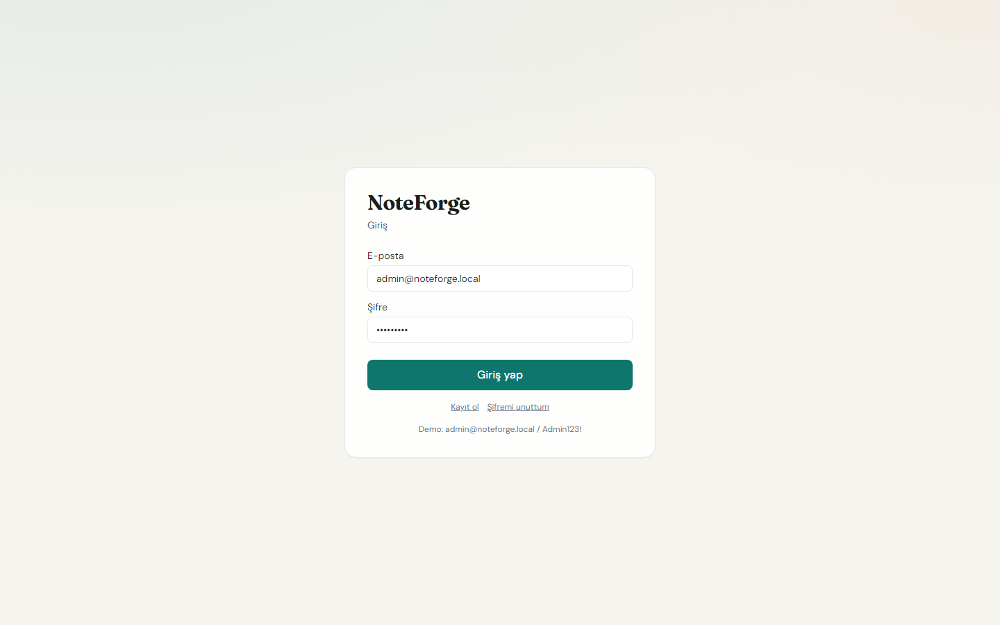
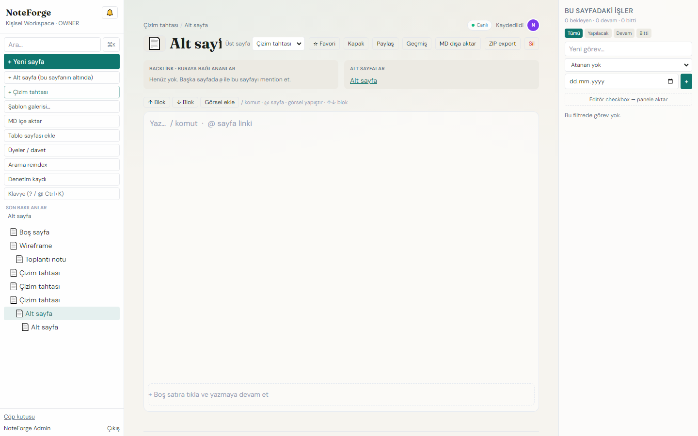
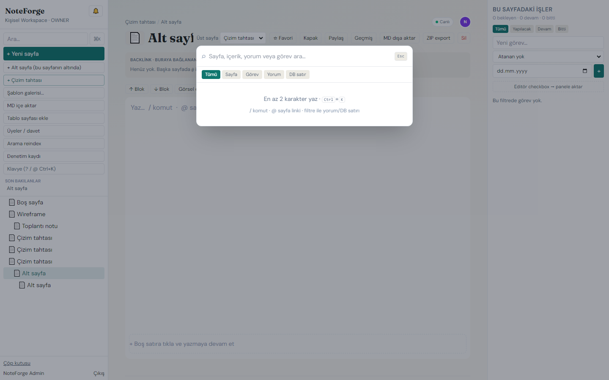
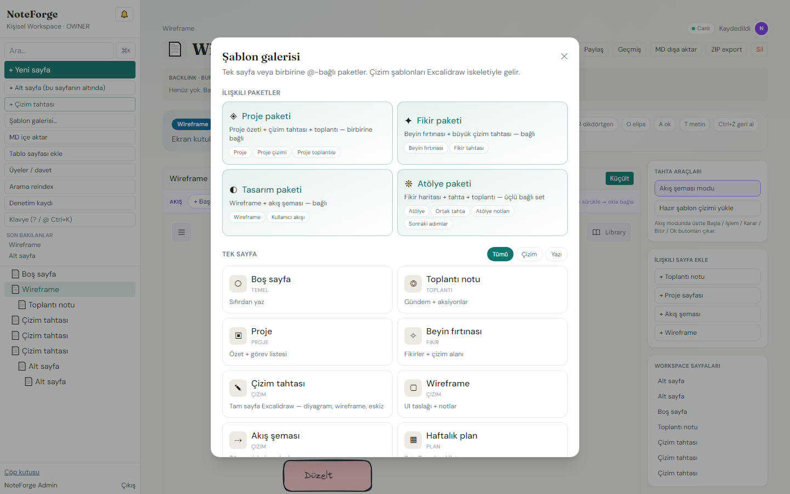
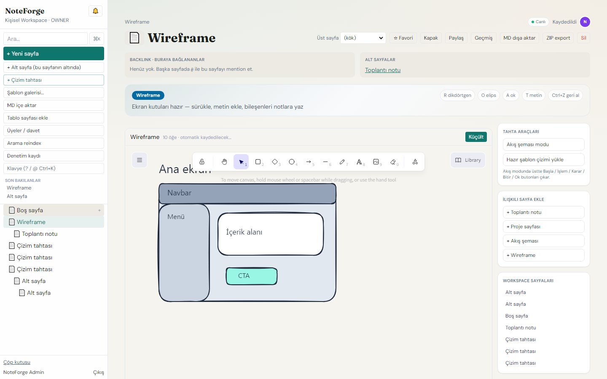
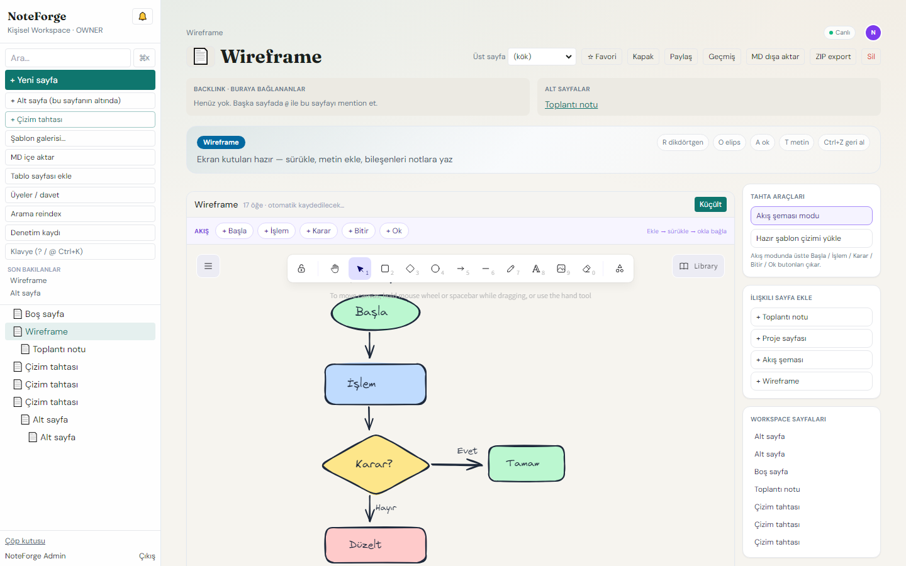

# NoteForge Web

[](https://github.com/hamzamaral/NoteForge-web/actions/workflows/ci.yml)


**NoteForge** arayüzü — Notion benzeri blok editör, görev paneli, Excalidraw tahta / akış şeması, veritabanı, paylaşım, canlı birlikte yazma ve **Ctrl+K** arama.

API: **[NoteForge-api](https://github.com/hamzamaral/NoteForge-api)**

---

## Ekranlar

### Giriş



Demo: `admin@noteforge.local` / `Admin123!`

### Workspace



Sol ağaç · TipTap · canlı sync (“Canlı”) · kaydet durumu

### Arama (Ctrl+K)



Başlık / içerik / görev + snippet

### Şablon galerisi



Tek sayfa veya @-bağlı paketler (proje, fikir, tasarım, atölye)

### Çizim tahtası (Excalidraw)



Wireframe / serbest tahta · otomatik kayıt · ilişkili sayfa ekle

### Akış şeması modu



Sağda **Akış şeması modu** → üstte `+ Başla` / `+ İşlem` / `+ Karar` / `+ Bitir` / `+ Ok`

---

## Özellik matrisi

| Alan | Ne var |
|------|--------|
| Editör | TipTap, `/` slash, `@` mention, görsel, ↑↓ blok |
| İlişkiler | Nested pages, backlink, görev paneli (due) |
| Çizim | Tam sayfa Excalidraw, şablon pack’ler, **akış araç çubuğu** |
| Database | Table + board, props CRUD, filter/sort, drag |
| Paylaşım | Token link, yorum (`blockId`), üye davet |
| Realtime | Socket `/sync` JWT, Yjs, remote caret, “Canlı” |
| Arama | Sidebar + **Ctrl+K** palet |
| Export | MD + ZIP |

---

## Quick start

Önce API’yi ayağa kaldır ([NoteForge-api](https://github.com/hamzamaral/NoteForge-api)), sonra:

```bash
npm install
npm run dev -- --host 127.0.0.1 --port 5174
```

| | |
|--|--|
| Web | http://localhost:5174 |
| Proxy | `/api` → `http://localhost:3001` |

```bash
npm test          # Vitest
npm run test:e2e  # Playwright
npm run build
```

---

## Docs

- [PRODUCT](docs/PRODUCT.md) · [INTERVIEW](docs/INTERVIEW.md) · [ARCHITECTURE](docs/ARCHITECTURE.md) · [DEMO](docs/DEMO.md) · [ROADMAP](docs/ROADMAP.md) · [BLOCK_SCHEMA](docs/BLOCK_SCHEMA.md)
- ADRs: [TipTap](docs/adr/0001-editor-tiptap.md) · [Tasks before DB](docs/adr/0002-tasks-before-db.md) · [Search ILIKE](docs/adr/0003-search-ilike.md)

---

## Notlar

- Çizim sahneleri kaydedilirken Excalidraw `collaborators` Map’i strip edilir; yüklemede boş `Map` ile restore edilir (panel çökmesini önler).
- Tahta sayfaları TipTap dışında `WhiteboardView` ile açılır — editör + canvas birlikte WSOD yapmaz.
